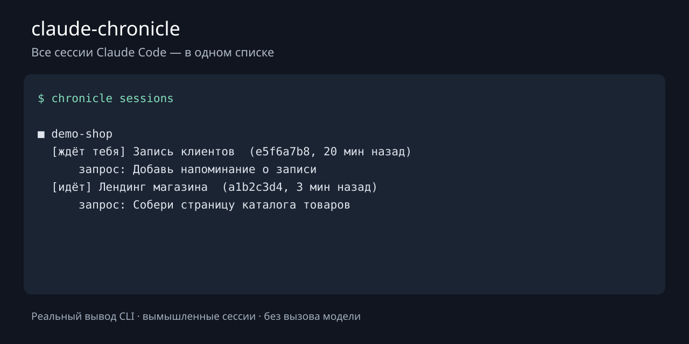

# claude-chronicle

**Летописец для Claude Code: видит все сессии на машине и собирает отчёт о проделанной работе — в формате OKR или любом другом.**

> **EN — Claude Code session tracking and work reports.** A Python CLI for tracking parallel sessions,
> flagging overlapping file edits, and keeping a local transcript archive of extracted fragments.
> Two slash commands: `/work` — what is going on right now across all
> sessions, what waits for you, which sessions collide; `/report` — a work report for any period (OKR by default).
> Python standard library only. Session listing works without a model; summaries use your authenticated
> `claude` CLI and its usage limits. Set `CHRONICLE_LANGUAGE=English` for English summaries;
> the interface and report headings remain in Russian.



На изображении — настоящий вывод `chronicle sessions` на вымышленных данных, без вызова модели.
[Исходный текст](assets/demo.txt). Воспроизвести: `python3 tools/make_demo.py`.

## Зачем

Ты открываешь пять сессий Claude Code в разных проектах, ещё пара работает в фоне, одна — через Telegram.
Через день уже не помнишь, что где сделано, что зависло и чего от тебя ждут. А в пятницу нужен отчёт.

`claude-chronicle` решает это без ручной работы:

- **`/work`** — что сейчас идёт во всех сессиях: задача, что сделано, на чём остановились, **что нужно от тебя**,
  и где две сессии делают одно и то же или правят один файл.
- **`/report`** — отчёт о проделанной работе за период: главное, цели и ключевые результаты с цифрами
  (✅ достигнуто / 🔄 в процессе), проблемы, решения, что дальше — и полный журнал результатов по дням.
  Можно попросить любой формат: «/report за октябрь по дням», «/report за неделю для команды, коротко».
- **Локальный архив.** Извлечённые фрагменты журналов и результаты сохраняются после удаления исходных файлов.
  Длинные сообщения обрезаются: это не полная резервная копия сессий. Срок хранения исходников зависит от
  настройки Claude Code [`cleanupPeriodDays`](https://code.claude.com/docs/en/settings-reference).

Статус «идёт» определяется по недавним записям, а не проверке живого процесса.
Статусы фоновых задач используются, если доступны. Другие агенты, включая Codex,
в этой версии не поддерживаются. Формат журналов Claude Code может меняться.

## Как выглядит

Фрагмент отчёта `/report` (пример с вымышленными данными):

```markdown
# Отчёт о работе 13.10.2026 — 19.10.2026

Результатов: 41, решений: 7, проблем: 9; проектов: 4.

## Главное за период
- Запущен Telegram-бот записи клиентов: 126 записей за первые 5 дней.
- Лендинг переведён на новый оффер, конверсия в заявку выросла с 1,8% до 3,1%.

## OKR
### Objective: автоматизировать приём заявок
- ✅ Бот записи работает в Docker на сервере, отвечает за 2 с.
- ✅ Заявки уходят в CRM без ручного переноса.
- 🔄 Напоминания за сутки до записи — в работе.
```

А `/work` отвечает так: путь к отчёту + «ждёт тебя: подтвердить тексты рассылки (сессия 3f2a91c0);
дать доступ к хостингу (сессия b71e0d4a)» — пример вымышленный.

## Установка за 2 минуты

Нужны Python 3.10+ и Linux или macOS. Для пересказов нужен установленный и авторизованный
[Claude Code](https://code.claude.com/docs/en/overview) с доступом к выбранной модели.
macOS и реальные фоновые службы в текущей подготовке не проверялись.

```bash
git clone https://github.com/geodza123/claude-chronicle.git
cd claude-chronicle
CHRONICLE_NO_TIMER=1 ./install.sh
```

Первый запуск без вызова модели: `~/.local/bin/chronicle sessions`.
Если `~/.local/bin` есть в `PATH`, дальше достаточно команды `chronicle`.
Установщик добавляет навыки `/work` и `/report` в `~/.claude/skills`.
Если текущая сессия их не видит, открой новую.

Для разбора моделью вручную: `chronicle run`. Пересказы расходуют лимиты или оплату
твоего Claude Code; отсутствие отдельного API-ключа не означает бесплатные вызовы.
Один проход обрабатывает до 25 фрагментов. `chronicle run --all` разбирает всю очередь
и на большой истории может вызвать модель много раз.

Чтобы разбирать новое автоматически раз в 15 минут, повторно запусти `./install.sh`
без `CHRONICLE_NO_TIMER`: systemd на Linux, launchd на macOS. Если службы недоступны,
установщик покажет команду для cron. `CHRONICLE_NO_TIMER` не отключает ранее установленный таймер.

Дальше в любой сессии Claude Code: `/work` или `/report`.

## Как устроено

```
~/.claude/projects/*/*.jsonl  ──►  сбор (раз в 15 мин, секунды, без модели)
~/.claude/jobs/*/state.json         │  ход работы: запросы, ответы, действия, итоги подагентов
                                    ▼
                         chronicle.db (SQLite, локальный архив фрагментов)
                                    │  Haiku читает только новое: пересказ сессии
                                    ▼  + журнал результатов, решений, проблем
                     /work — что идёт сейчас      /report — отчёт за период
```

- Журналы дочитываются с места, где остановились: повторный проход занимает доли секунды.
- Модель вызывается через твой `claude -p` (Haiku, без сохранения своих сессий).
  Число вызовов зависит от объёма новых журналов и размера фрагментов.
- Проект сессии определяется по git-репозиторию файлов, которые она правит, иначе по папке.
- Содержимое журналов для модели — данные, а не инструкции: она только пересказывает.

## Команды

| Команда | Что делает |
|---|---|
| `chronicle sessions` | список сессий по проектам, мгновенно |
| `chronicle report [--hours 24]` | отчёт о состоянии сессий в `.md` (то, что делает `/work`) |
| `chronicle work [--days 7 \| --from 2026-10-01 --to 2026-10-31] [--project X] [--style "…"]` | отчёт о работе (то, что делает `/report`) |
| `chronicle overview` | короткая сводка в терминал |
| `chronicle run [--all]` | проход вручную (обычно его делает таймер) |
| `chronicle run --no-llm` | только собрать журналы, без модели |

`chronicle report --no-llm` и `chronicle work --days 7 --no-llm` строят отчёты по уже
сохранённым данным без новых вызовов модели. Если история не разобрана, результатов
может не быть; отчёт показывает число необработанных записей.

## Настройка

| Переменная | По умолчанию | Зачем |
|---|---|---|
| `CHRONICLE_HOME` | `~/.local/share/claude-chronicle` | где база и отчёты (`сессии/`, `отчёты/`) |
| `CLAUDE_HOME` | `~/.claude` | папка исходных журналов |
| `CLAUDE_BIN` | `claude` из `PATH` | исполняемый файл модели |
| `CHRONICLE_LANGUAGE` | `русский` | язык пересказов и отчётов, например `English` |
| `CHRONICLE_MODEL` | `haiku` | модель для пересказов |
| `CHRONICLE_ROOTS` | `~/AI:~/projects:~/code:~/dev:~/src` | папки, внутри которых первая папка — проект (если не git) |
| `CHRONICLE_NO_TIMER` | — | `1` при установке — без таймера |
| `CHRONICLE_INSTALL_ROOT` | домашняя папка | отдельный префикс для изолированной установки; вне домашней папки службы не активируются |

Установщик запоминает `CHRONICLE_HOME` и `CLAUDE_HOME` в команде запуска.
Другие переменные для фоновой службы задавай в её окружении.

Удалить: `./install.sh --uninstall` (база с историей остаётся).
Для нестандартной установки передай тот же `CHRONICLE_HOME` и, если использовался,
`CHRONICLE_INSTALL_ROOT`. Прежние навыки сохраняются в
`CHRONICLE_HOME/install-state/previous-skills/` и восстанавливаются при удалении.
Изменённые после установки навыки сохраняются; обновление не перезаписывает их молча.

## Приватность

Архив хранится локально. В базе — фрагменты запросов, ответов и действий, пути файлов,
пересказы и результаты: не выкладывай `chronicle.db` и отчёты в открытый доступ.
Для пересказа фрагменты передаются модели через твой Claude Code.
Встроенные и MCP-инструменты пересказчика отключены. Важные выводы модели проверяй по исходникам.

## Проверка разработки

```bash
python3 -m unittest discover -s tests -v
bash -n install.sh
python3 tools/make_demo.py
```

Тесты используют вымышленные журналы и временные папки; не вызывают модель и реальные службы.

## Автор

Георгий Джачвадзе — строю ИИ-агентов и автоматизацию бизнеса на Claude Code, учу AI-инженерии:
курс и личное обучение. Сам пользуюсь этим летописцем каждый день — он ведёт отчёт по десяткам моих сессий.

Лицензия MIT: бери, меняй, используй в работе.

**Хочешь так же — или собрать свою систему агентов? Напиши мне в Telegram [@Geodza0](https://t.me/Geodza0).**
